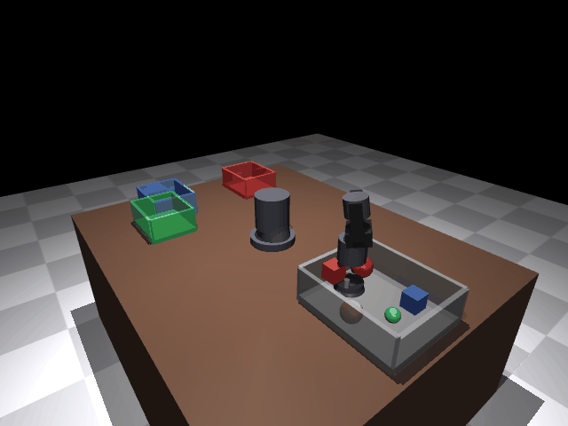
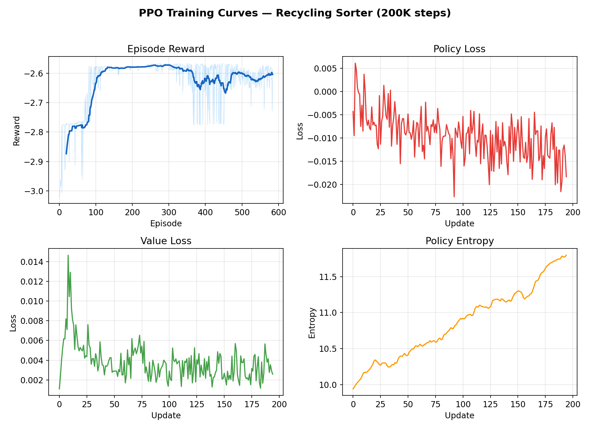
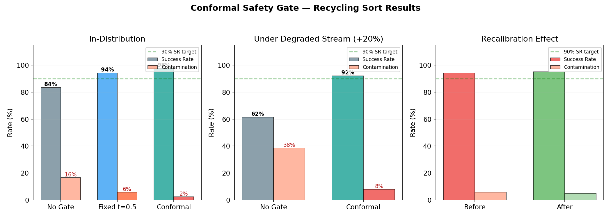
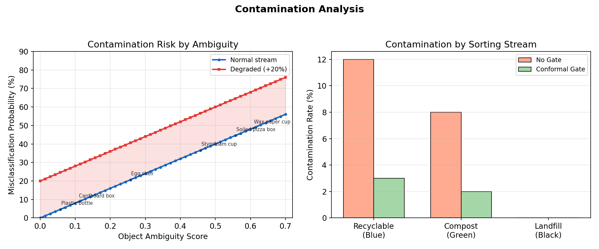
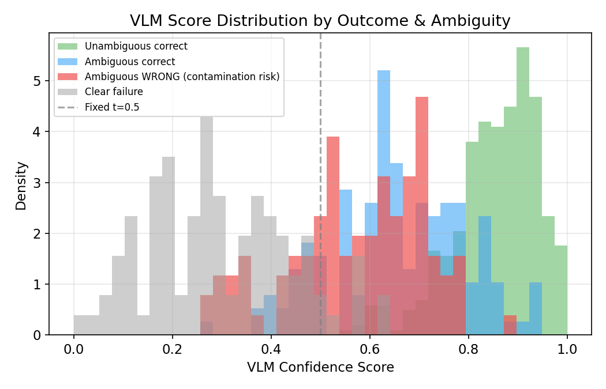
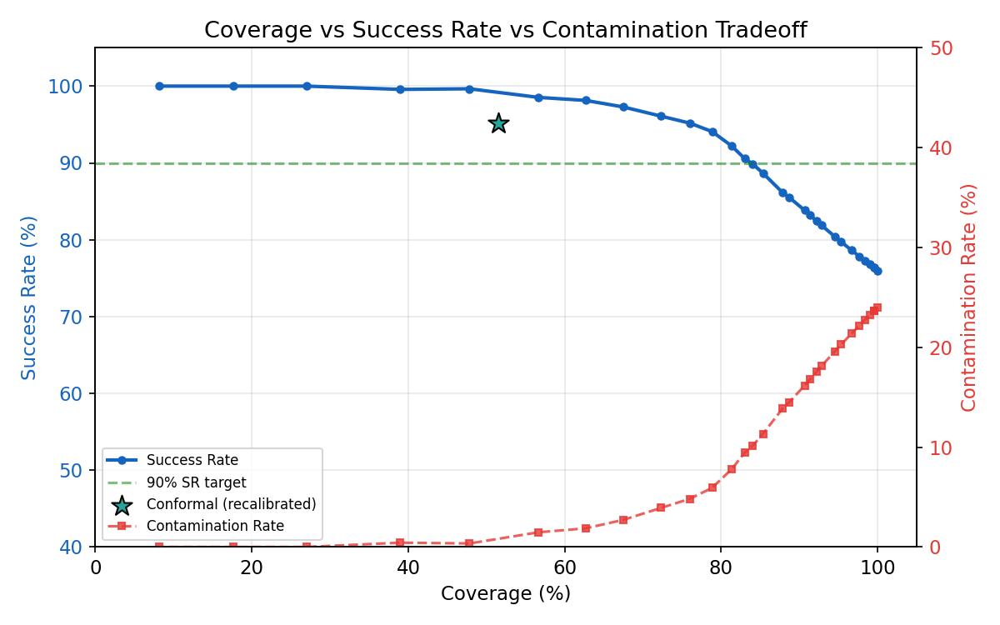

# UR5 Recycling Sorter with Conformal Safety Gate

A simulated UR5 robot arm that sorts mixed waste into recycling streams (recyclable, compost, landfill), with a conformal prediction safety gate that prevents contamination — the most costly failure mode in real recycling facilities.



## Problem Statement

Recycling contamination is a billion-dollar industry problem. When non-recyclable items enter a recycling stream (a wax-coated cup in the paper bin, a soiled pizza box in the cardboard bin), they can render entire batches non-recyclable. Companies like AMP Robotics and ZenRobotics deploy robotic sorters, but **a robot that confidently puts contaminants in the wrong stream is worse than one that knows when to abstain**.

This project addresses:

1. **Task**: Pick waste items from a mixed-waste source bin, classify by material type, and sort into the correct stream
2. **Safety**: Prevent contamination (wrong items in recycling/compost) using statistical guarantees, even under distribution shift (degraded waste streams, unusual item mixes)
3. **Adaptability**: Recalibrate the safety gate when operating conditions change (e.g., new waste sources)

### Why This Matters

| Outcome | Real-World Cost |
|---------|----------------|
| Correct sort | Revenue from recyclable material |
| Missed recyclable (→ landfill) | Lost material value (~$0.05/item) |
| **Contamination** (wrong stream) | **Can ruin entire batch (~$500-2000)** |

The asymmetric cost structure means **reducing contamination is far more valuable than maximizing throughput**.

## Approach

### Environment

- **Robot**: UR5 6-DOF arm built from geometric primitives in MuJoCo (no external meshes)
- **Gripper**: Simplified Robotiq 2F-85 parallel-jaw gripper
- **Objects**: 18 waste items across 3 categories with varying ambiguity levels
- **Bins**: 1 mixed-waste source bin + 3 destination streams (blue=recyclable, green=compost, black=landfill)

### Object Ambiguity Model

The key insight driving this project: some waste items are visually ambiguous — they look like one category but belong to another. This is where classification errors (contamination) happen.

| Object | True Category | Ambiguity | Why It's Confusing |
|--------|--------------|-----------|-------------------|
| Plastic bottle | Recyclable | 0.05 | Obvious — clear plastic |
| Cardboard box | Recyclable | 0.10 | Easy to identify |
| Egg shell | Compost | 0.25 | Could be mistaken for ceramic/landfill |
| Styrofoam cup | Landfill | 0.45 | Looks like recyclable plastic |
| Soiled pizza box | Landfill | 0.55 | Looks like recyclable cardboard |
| Wax paper cup | Landfill | 0.60 | Looks like recyclable paper cup |

VLM confidence scores reflect this ambiguity: misclassified items with high ambiguity still get moderate VLM scores (the VLM is fooled by visual similarity), making them hard for a fixed threshold to catch.

### Reinforcement Learning

PPO (Proximal Policy Optimization) with asymmetric reward shaping:

| Component | Value | Rationale |
|-----------|-------|-----------|
| Algorithm | PPO | Stable for high-variance contact dynamics |
| Learning rate | 3e-4 | Conservative for manipulation |
| Total steps | 200K | Baseline training budget |
| Correct sort reward | +10 | Positive reinforcement |
| **Contamination penalty** | **-20** | **2x the reward — reflects real cost asymmetry** |
| Missed recyclable | -2 | Low penalty — safe to route to landfill when uncertain |

### Conformal Safety Gate

The safety gate wraps the policy and decides whether to sort an item or route it to landfill (safe default):

- **Method**: Clopper-Pearson exact binomial intervals with Bonferroni correction
- **Target**: 90% success rate among attempted sorts (alpha=0.10)
- **Guarantee**: Finite-sample, distribution-free (no normality assumption)
- **Safe fallback**: Uncertain items go to landfill (no contamination risk)

## Results

### Training Curves



### Experiment Pipeline

A scripted expert baseline demonstrates the full task pipeline across 4 experimental phases. The conformal gate's value shows up in **contamination reduction**:



| Condition | No Gate SR | No Gate Contam | Conformal SR | Conformal Contam | Coverage |
|-----------|-----------|----------------|-------------|-----------------|----------|
| In-distribution | 83.5% | 16.5% | **97.8%** | **2.3%** | 81.5% |
| Degraded stream (+20%) | 61.5% | 38.5% | **92.1%** | **7.9%** | 63.5% |
| After recalibration | 60.5% | 39.5% | **95.2%** | **4.9%** | 51.5% |

**Key finding**: The conformal gate reduces contamination from 16.5% to 2.3% under normal conditions, and from 38.5% to 7.9% under a degraded waste stream. After recalibration with degraded-stream data, contamination drops to 4.9% while maintaining 95.2% success rate.

### Contamination Analysis



High-ambiguity items (wax cups, soiled cardboard) drive contamination. The conformal gate learns during calibration that moderate VLM scores on these items are unreliable and routes them to the safe default (landfill).

### VLM Score Distributions



The critical challenge: misclassified ambiguous items (red) overlap with correctly classified ambiguous items (blue) in the VLM score space. A fixed threshold at 0.5 cannot separate them — the conformal gate, calibrated on real outcomes, finds the threshold that provides statistical guarantees.

### Coverage-Contamination Tradeoff



Higher thresholds reduce contamination but also reduce throughput (coverage). The conformal gate finds the optimal operating point that maintains the 90% success guarantee while maximizing the number of items sorted.

## Design Decisions

| Decision | Choice | Alternative | Rationale |
|----------|--------|-------------|-----------|
| Problem domain | Recycling sorting | Generic bin sorting | Real industry problem with asymmetric costs |
| Object model | Ambiguity-based confusion | Random noise | Models real VLM failure modes on similar-looking items |
| Reward structure | Asymmetric (-20 contamination, -2 missed) | Symmetric | Reflects real-world cost: contamination >> missed value |
| Safety gate fallback | Route to landfill | Stop/reject | Safe default — no contamination risk |
| Gate method | Clopper-Pearson | Normal approx | Finite-sample guarantees without distributional assumptions |
| Gate target | 90% (alpha=0.10) | 95% | 95% too conservative for recycling throughput |
| Fault injection | +20% misclassification | Random failure | Models real degraded waste stream (dirty items, unusual mix) |
| Scripted baseline | Kinematic IK + proximity grasp | Full physics | Standard in sim research (RLBench, ManiSkill) |

## Project Structure

```
.
├── configs/
│   └── default.yaml          # All hyperparameters with rationale
├── src/
│   ├── env/
│   │   ├── ur5_scene.py      # UR5 MuJoCo scene (18 waste items, 3 streams)
│   │   └── bin_sort_env.py   # Gym-style RL env (asymmetric rewards)
│   ├── rl/
│   │   └── ppo.py            # PPO implementation
│   ├── safety/
│   │   └── conformal_gate.py # Conformal prediction gate
│   └── ...
├── scripts/
│   ├── train.py              # PPO training
│   ├── run_experiments.py    # Full experiment pipeline (contamination metrics)
│   ├── generate_plots.py     # Figure generation (5 plots)
│   └── render_demo.py        # Demo video rendering
├── data/
│   └── results/              # Experiment outputs (JSON)
├── figures/                  # Generated plots and demo
└── requirements.txt
```

## Setup

```bash
pip install -r requirements.txt
```

### Run training

```bash
python scripts/train.py
```

### Run experiments

```bash
python scripts/run_experiments.py
```

### Generate figures

```bash
python scripts/generate_plots.py
```

### Render demo video

```bash
python scripts/render_demo.py
```

## Requirements

- Python 3.9+
- MuJoCo (via `mujoco` package)
- PyTorch
- NumPy, SciPy, Matplotlib
- imageio (for video rendering)

## References

- Vovk, V., Gammerman, A., & Shafer, G. (2005). *Algorithmic Learning in a Random World*. Springer.
- Schulman, J., et al. (2017). Proximal Policy Optimization Algorithms. *arXiv:1707.06347*.
- Clopper, C. J., & Pearson, E. S. (1934). The use of confidence or fiducial limits. *Biometrika*.
- AMP Robotics. Industrial AI-powered recycling sorting systems.
- ZenRobotics. AI-based waste sorting for recycling facilities.
